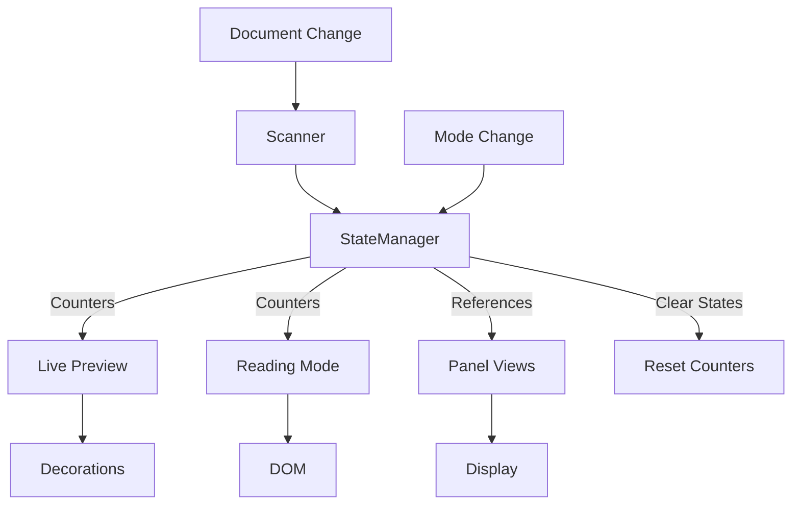

# Pandoc Extended Markdown Plugin Architecture

> Comprehensive technical documentation for the pandoc-extended-markdown plugin. This document helps developers understand existing implementations, debug issues, and extend functionality without duplicating code.

## Table of Contents

1. [Overview](#overview)
2. [Core Architecture](#core-architecture)
3. [Component Inventory](#component-inventory)
4. [Processing Pipeline Details](#processing-pipeline-details)
5. [Implementation Patterns](#implementation-patterns)
6. [Extension Guide](#extension-guide)
7. [Pandoc Export Module](#pandoc-export-module)

## Overview

This plugin extends Obsidian's markdown rendering to support Pandoc's extended syntax. It operates in two distinct modes with shared state management:

- **Live Preview Mode**: Real-time syntax transformation using CodeMirror 6 decorations
- **Reading Mode**: Post-processing of rendered HTML using DOM manipulation

The optional Pandoc export backend is a separate desktop-only module. It is not required for either rendering mode, is disabled by default, and is not registered on mobile.

### Supported Syntax

| Syntax Type | Examples | Implementation |
|-------------|----------|----------------|
| **Fancy Lists** | `A.`, `i.`, `(a)` | FancyListProcessor |
| **Hash Lists** | `#.` auto-numbering | HashListProcessor |
| **Example Lists** | `(@label)` with references | ExampleListProcessor |
| **Custom Labels** | `{::LABEL}` with placeholders | CustomLabelProcessor |
| **Definition Lists** | `: definition`, `~ definition` | DefinitionProcessor |
| **Fenced Divs** | `::: {.theorem #id title="Theorem &"}` or readable `::: Theorem & #id` renders `Theorem 1`; `@id` → `Theorem 1` | FencedDivProcessor + FencedDivReferenceProcessor |
| **Superscript** | `^text^` with escaped spaces | SuperscriptProcessor |
| **Subscript** | `~text~` with escaped spaces | SubscriptProcessor |
| **Smart Dashes** | `--` → en dash, `---` → em dash | SmartDashProcessor |

## Core Architecture

### Design Principles

1. **Two-Phase Processing Pipeline**
   - Phase 1: Structural (block-level) processing
   - Phase 2: Inline (content) processing
   - Clean separation prevents interference between processors

2. **Base Class Hierarchy**
   - `BaseWidget`: Common widget functionality (DOM creation, events, lifecycle)
   - `BaseStructuralProcessor`: Shared structural processor logic (cursor detection, decorations, context)
   - `BasePanelModule`: Shared panel logic (state, updates, rendering)
   - Reduces duplication, ensures consistency

3. **Centralized Configuration**
   - Constants organized in modular structure:
     - `/core/constants.ts`: Main constants and re-export surface
     - `/core/constants/listConstants.ts`: LIST_MARKERS, LIST_TYPES, INDENTATION
     - `/core/constants/cssConstants.ts`: CSS_CLASSES, COMPOSITE_CSS, DECORATION_STYLES
   - All patterns in `ListPatterns` class (`/shared/patterns.ts`)
   - All types in `/shared/types/` directory

4. **State Management**
   - Document-specific: PluginStateManager
   - Processing artifacts: ProcessingContext
   - User preferences: Settings

5. **Feature Flags**
   - Syntax enable/disable state is centralized in `shared/types/settingsTypes.ts`
- `normalizeSettings()` keeps persisted settings consistent and migrates the former inverted `enforcePandocListSpacing` flag to `enableListsWithoutPrecedingBlankline`
   - `isSyntaxFeatureEnabled()` is the shared gate for live preview, reading mode, editor suggestions, autocompletion, and panel visibility
   - Settings UI groups syntax toggles separately from list auto-completion controls and sidebar panel controls
   - Unordered list marker cycling and source-aware marker rendering are separate settings so keyboard behavior and visual styling can be enabled independently
   - Unordered list marker cycling has a configurable nesting-depth order for `-`, `+`, and `*`
   - Ordered list marker cycling is a keyboard-only setting with a configurable context order for supported non-auto ordered markers: decimal, alpha, and roman variants using `.` or `)`

6. **Error Handling**
   - Centralized error handling with `errorHandler.ts`
   - `withErrorBoundary()` for synchronous operations
   - `withAsyncErrorBoundary()` for async operations
   - Consistent error context and recovery patterns

7. **Code Quality Standards**
   - Maximum 400 lines per file
   - Maximum 50 lines per function
   - Import order: External → Types → Constants → Patterns → Utils → Internal
   - All hardcoded values in constants
   - Proper TypeScript types (no `any` without justification)

### Architectural Patterns

| Pattern | Purpose | Implementation |
|---------|---------|----------------|
| **Template Method** | Standardize widget lifecycle | BaseWidget.toDOM() |
| **Strategy** | Select processor per syntax | Processor.canProcess() |
| **Observer** | React to mode changes | StateManager.onModeChange() |
| **Registry** | Extensible content processing | ContentProcessorRegistry |
| **Chain of Responsibility** | Process lines or DOM features sequentially | ProcessingPipeline, ReadingModePipeline |

## Component Inventory

### Live Preview Components

#### Structural Processors (`/live-preview/pipeline/structural/`)

All structural processors extend `BaseStructuralProcessor` which provides:
- `isCursorInMarker()`: Check if cursor is within marker range
- `isInvalidPandocListLine()`: Check whether Pandoc parses a candidate marker as paragraph text
- `createLineDecoration()`: Create standard line decorations
- `createContentMarkDecoration()`: Create content area decorations
- `createMarkerReplacement()`: Create marker replacement widgets
- `createContentRegion()`: Define regions for inline processing
- `setListContext()`: Update list context for continuation detection
- `processStandardList()`: Template method for standard list processing

| Processor | Priority | Purpose | Triggers On | Extends |
|-----------|----------|---------|-------------|---------|

* CustomLabelProcessor is modularized into `/customLabel/` subdirectory for better organization
| **HashListProcessor** | 10 | Auto-number `#.` lists | `^\s*#\.` | BaseStructuralProcessor |
| **CustomLabelProcessor*** | 15 | Process `{::LABEL}` markers | `^\s*\{::` | StructuralProcessor |
| **FencedDivProcessor** | 18 | Render fenced div open/content/close lines | unindented `:::` with Pandoc-recognized attributes, plus readable shorthand when enabled, at block boundaries | BaseStructuralProcessor |
| **FancyListProcessor** | 20 | Letter/Roman lists | `^\s*[A-Za-z0-9]+[.)]` | BaseStructuralProcessor |
| **DefinitionProcessor** | 20 | Definition list items | `^:\s` or `^~\s` | StructuralProcessor |
| **ExampleListProcessor** | 30 | Example lists `(@label)` | `^\s*\(@` | BaseStructuralProcessor |
| **StandardListProcessor** | 25 | Adds source-marker classes to standard unordered lists when distinct marker rendering is enabled while preserving native rendering | `^\s*[-*+]\s+` | StructuralProcessor |
| **ListContinuationProcessor** | 100 | Indented continuations | Indented non-empty lines | StructuralProcessor |

Fancy, hash, and example structural processors recognize Pandoc task modifiers
after their base marker. They render the checkbox with Obsidian's native task
classes, attach task state to the editor line, and keep the task prefix outside
inline content regions. Native unordered and decimal task lists remain owned by
Obsidian. A validator-rejected marker suppresses list-specific decoration only;
the rest of the structural and inline pipeline still runs so fenced-div and
other container processors preserve that line as ordinary content.

Live Preview also registers `fencedDivDragExtension`, a small CodeMirror view
plugin that listens for left-button drags that begin on a fenced-div rail and
moves the matching source block as whole lines. It is intentionally separate
from `FencedDivProcessor`, which remains responsible only for parsing and
decorations.

#### Inline Processors (`/live-preview/pipeline/inline/`)

| Processor | Priority | Processes | Regions |
|-----------|----------|-----------|---------|
| **ExampleReferenceProcessor** | 10 | `(@ref)` → `(number)` | list-content, definition-content |
| **FencedDivReferenceProcessor** | 12 | `@id` → fenced-div `referenceText` such as `Proposition 1` or `Warning` | normal, fenced-div-content, list-content, definition-content |
| **SuperscriptProcessor** | 20 | `^text^` → superscript | list-content, definition-content |
| **SubscriptProcessor** | 20 | `~text~` → subscript | list-content, definition-content |
| **SmartDashProcessor** | 35 | Pandoc smart dash runs: `--` → en dash and `---` → em dash; longer runs are consumed greedily as triples, then doubles, with a final single hyphen preserved | normal, fenced-div-content, list-content, definition-content |
| **CustomLabelReferenceProcessor** | 40 | `{::ref}` → processed | list-content, definition-content |

#### Widgets (`/live-preview/widgets/`)

All widgets extend `BaseWidget` which provides:
- `toDOM()`: Template method for rendering
- `applyStyles()`: CSS class application
- `setContent()`: Content insertion
- `setupClickHandler()`: Cursor positioning
- `destroy()`: Cleanup with AbortController

| Widget | Extends | Renders |
|--------|---------|---------|
| **FancyListMarkerWidget** | BaseWidget | `A.`, `i.`, `(a)` markers |
| **HashListMarkerWidget** | BaseWidget | Auto-numbered markers |
| **ExampleListMarkerWidget** | BaseWidget | `(@label)` → `(n)` with tooltip |
| **TaskCheckboxWidget** | BaseWidget | Interactive `[ ]`, `[x]`, and `[X]` task modifiers |
| **DuplicateExampleLabelWidget** | BaseWidget | Error styling for duplicates |
| **CustomLabelMarkerWidget** | BaseWidget | `{::LABEL}` processed markers |
| **CustomLabelPartialWidget** | BaseWidget | Partial label rendering |
| **CustomLabelPlaceholderWidget** | BaseWidget | `#a` → number |
| **CustomLabelProcessedWidget** | BaseWidget | Fully processed labels |
| **CustomLabelInlineNumberWidget** | BaseWidget | Inline number replacements |
| **CustomLabelReferenceWidget** | BaseWidget | `{::ref}` with hover preview |
| **DuplicateCustomLabelWidget** | BaseWidget | Error styling for duplicates |
| **DefinitionBulletWidget** | BaseWidget | Definition list bullets |
| **FencedDivHeaderWidget** | BaseWidget | Fenced div opener placeholder with generated theorem-style title text and optional id tooltip |
| **FencedDivClosingWidget** | BaseWidget | Hidden closing fence placeholder |
| **FencedDivReferenceWidget** | BaseWidget | `@id` → rendered fenced-div reference with hover preview |
| **ExampleReferenceWidget** | BaseWidget | `(@ref)` → `(n)` with hover |
| **SuperscriptWidget** | BaseWidget | Superscript formatting |
| **SubscriptWidget** | BaseWidget | Subscript formatting |
| **SmartDashWidget** | BaseWidget | Rendered Pandoc smart dash text |

### Reading Mode Components

Reading mode uses a small processor pipeline around rendered preview DOM. The public entrypoint remains `processReadingMode(element, context, config, app?)`; it builds a `ReadingModeContext` and runs the default registry from `/reading-mode/pipeline/registry.ts`.

#### Pipeline Core (`/reading-mode/pipeline/`)

| File | Purpose |
|------|---------|
| **ReadingModePipeline.ts** | Registers processors and runs enabled processors in priority order |
| **types.ts** | Defines `ReadingModeContext`, `ReadingModeProcessor`, `BlockDomProcessor`, `InlineTextProcessor`, and Obsidian app adapter types |
| **registry.ts** | Builds the default processor set and shared context |

`ReadingModeContext` contains the rendered root element, Obsidian post-processor context, preview section and section info, source path, optional full source, processor config, render context, document counters, app adapter, and source lines used for Pandoc list validation.

#### Block/DOM Processors (`/reading-mode/pipeline/processors/`)

| Processor | Priority | Purpose |
|-----------|----------|---------|
| **UnorderedListMarkerProcessor** | 20 | Adds or clears source-marker classes on rendered unordered list items |
| **DefinitionListNormalizationProcessor** | 40 | Schedules delayed normalization/rebuild of rendered definition lists, using full source when available |
| **FencedDivBlockProcessor** | 60 | Schedules section-scoped fenced div block rendering |
| **NativeListSpacingProcessor** | 70 | Reconciles assembled container DOM with Pandoc's `lists_without_preceding_blankline` block behavior |
| **ExtendedListBlockProcessor** | 120 | Preserves existing rendered behavior for hash, fancy, example, and source-backed definition list paragraphs |
| **InlineTextEngineProcessor** | 300 | Runs registered inline processors through the shared text-node replacement engine |
| **CustomLabelListProcessor** | 400 | Runs the existing two-pass custom label list processor after other replacements |

Extended ordered-list rendering emits Pandoc-compatible task item content and
Obsidian task classes. Checkbox inputs carry section-relative source line
metadata so Reading Mode clicks use Obsidian's existing source-toggle handler.
Rendered extended markers are assigned to source lines by their section bounds
and document order before any DOM mutation. The shared validator exposes only
marker candidates reached outside opaque blocks, so duplicate text in fenced
code cannot capture a later rendered list. If a source-backed marker cannot be
located unambiguously, it remains untouched. Validation retains absolute source
indices; only final checkbox metadata is converted to the host block's relative
coordinate. `semanticBlockRenderer.ts` can split a validated trailing hash,
fancy, or example-list suffix from either a paragraph or an existing native
list item. It preserves the paragraph prefix or native item and inserts the
semantic list as a sibling or child, respectively, so extended children are not
flattened into native-parent text.
Before changing either container, `renderedLineProjection.ts` maps every rendered
list line to DOM boundaries and verifies the source marker prefix. It then moves
the existing rendered content into each new list item, preserving images, links, emphasis,
code, and host-rendered math. Unmappable lines leave the original DOM in place.
Task content moves inside the checkbox label, and raw math still uses the math
renderer. The inline pipeline processes moved example-list text while skipping
only generated marker spans. Parenthesized ordered lists use native list-item
markers with the list type and `start` value, keeping markers in the normal
list layout.

`ListBlockValidator` is the shared source-state analyzer for Live Preview and
Reading Mode. `enableListsWithoutPrecedingBlankline` is the direct, positive
representation of Pandoc's `lists_without_preceding_blankline` extension:
`true` targets `markdown+lists_without_preceding_blankline`, and `false` targets
`markdown-lists_without_preceding_blankline`. There is no separate strict-mode
switch. The same setting is passed through native, extended, and definition-list
recognition, including nested lists and container transitions, so disabling it
prevents a recognized list from interrupting an open paragraph wherever Pandoc
does. Paragraph and list state belong to their containers: a
physical blank can end lazy quote membership, whereas a deeper bare quote marker
within a list item can remain literal continuation text. Nested lists and text
following a valid list follow Pandoc's list grammar, not a blanket blank-line
rule. When the extension is enabled, a valid marker which returns from a rejected
deeper quote to the paragraph's container closes that rejected interruption and
is reconsidered as a new list block; when disabled, it remains part of the same
literal paragraph. Indentation is measured in visual columns throughout list parsing,
validation, continuation handling, and editor list structure. A tab advances to
the next four-column tab stop (`4 - column % 4`), rather than always adding four
columns; nested-list ownership is therefore relative to the parsed parent
marker's content column, including wide ordered markers such as `100.`.
The optional installed-Pandoc oracle suite checks both extension states across
block/container prefixes and compares nested-list classification and topology,
including wide ordered markers and mixed space/tab indentation. Pandoc remains a
development oracle rather than a runtime dependency.

The analyzer also recognizes Pandoc block boundaries such as headings, fenced code,
tables, HTML/native divs, fenced divs, line blocks, raw TeX commands, YAML
metadata, and definition lists so paragraph continuation text is not mistaken
for a standalone block. Raw TeX environments and indented multiline backtick
spans remain in paragraph state, as they do in Pandoc; list-looking text inside
those spans is kept opaque to list matching. Fenced-div delimiters establish
container boundaries, while each fenced-div body uses the same list-spacing
state machine as the document root.
Reference definitions are recognized as complete destination/title/attribute
ranges by `pandocReferenceDefinitions`, rather than by a prefix alone.
`pandocRawTexBlocks` uses balanced arguments and Pandoc's inline-command table
(`pandocTexCommandNames`) to distinguish raw blocks from paragraph content.
`PandocBlockEntryWhitespace` models reader-cursor indentation consumed after raw
TeX and at raw HTML body block entries. It does not dedent paragraph or list
continuations; normalized entry lines are returned in the analysis's source map.
Pandoc footnote definitions are projected into independent body regions with
their continuation indentation removed before that same state machine runs.
This keeps the setting effective for both indented and lazy unindented lists in
a note without allowing paragraph state to leak between the note and document.
`PandocListItemContinuations` also records source-owned literal continuations as
structured `literalListContinuations` ranges. Each range carries its parent line,
inclusive source bounds, the exact list-looking marker lines, and whether Pandoc
classifies the range as paragraph or code content. Footnote-body ranges are
projected back to their original document indices before `ListBlockAnalysis` is
returned.

When Obsidian has already emitted native list DOM for a list Pandoc keeps inside
a paragraph, `NativeListSpacingProcessor` escapes only the affected source
markers and renders that source through Obsidian's Markdown renderer. The
replacement is atomic and source-backed, preserving inline markup, task text,
lazy continuations, and every nested marker. Matches are ordered against the
full source and use renderer-derived lead-text signatures, so repeated or
prefix-matching item text cannot redirect a replacement to an earlier valid
list. Indented backtick spans that Obsidian initially materializes as fenced code
are normalized back to inline code during the paragraph render. Replacement
ranges stop at the analyzer's Pandoc block boundary, while an
indented block suffix that Obsidian materialized under the consumed item is retained.
Subtree ownership removes only the quote prefixes shared with the owning item, so
a nested block quote keeps its physical indentation instead of being mistaken for
a root sibling. When the first source-owned suffix block can be matched exactly,
the processor promotes that block and every following source-owned block sibling
intact. Otherwise it renders the complete source-owned subtree, preserving content
without guessing at DOM ownership. A following outer list tail is merged into a
promoted list only when Pandoc keeps both markers in the same group: unordered
markers are compatible, while ordered markers must have the same numeral style and
delimiter. Mixed list kinds and incompatible forms such as `1)` followed by `7.`
remain separate blocks.
Block-quote wrappers that Obsidian creates for a deeper marker inside an outer
Pandoc paragraph are reconciled at the paragraph's actual container depth, and
the excess quote markers remain literal text. DOM cleanup removes only matched
list blocks or an otherwise source-owned quote wrapper; it never consumes the
unmatched siblings between separate list segments. Paragraph replacements own
the exact matched paragraph, not its preview wrapper. Cleanup prunes empty
containers only, retaining unmatched wrapper children. Async replacements
revalidate individual matched item identities after rendering, not just list
or root membership.
For a literal paragraph continuation whose indent remains before its parsed
parent's content column, the processor passes the analyzer's structured range to
`literalContinuationReconciler.ts`. This is marker-width-relative behavior; a
wide ordered marker is one example, not a special case. The reconciler acts only
when an exact intervening host code block matches the source range. It renders
the escaped continuation as inline content, matches the parent and any following
same-list sibling by rendered source signature, and preflights every node before
mutation. The original parent item, following item, and compatible list nodes
are retained; only the matched code block and an emptied split-list wrapper are
removed. If source, topology, or a generation check no longer matches,
reconciliation is a no-op, so unrelated siblings and live event handlers are
never consumed.
Per-preview generations cancel stale asynchronous work after source, mode, or
setting changes. The plain-source fallback is used only when the application
renderer is unavailable. Fenced-div assembly moves a native list together with
its root list block, preserving nested list structure instead of detaching list
items from their container.
Captured fenced-div closings use a source-checked list-prefix split: only the
delimiter is removed, existing item subtrees move together, and a shared outside
list tail retains its original list/item nodes and ordered numbering. Native
list items never enter the paragraph-fragment splitter. Delimiter removal
preflights the entire text suffix before mutating live DOM.
Captured prefixes are matched against renderer-derived source signatures when
the application renderer is available, preserving inline-extension semantics.
Fenced-div coordination awaits actual section assembly, including its deferred
DOM pass, before native-list reconciliation starts.
Lazy quote normalization also runs when the host produced a code block and no
native list items. Whole source-region render signatures identify the owning
quote; only source-matched code blocks, thematic breaks, or excess quote
wrappers are reconciled. Literal quote-prefix restoration inserts text around
the original inline nodes, retaining links, widgets, and event listeners.
Footnote endnote-index lists are excluded from native-list matching; only a
list rooted in a footnote body is eligible. When Obsidian materializes a lazy
footnote list at the document root, its source label and generated reference
target identify the exact footnote item before matched list items are moved.
Strict paragraph demotion then runs inside that item, retaining the endnote
index, footnote item, backlink DOM, unmatched list tails, and event listeners.

Definition-list source parsing uses the same `ListBlockValidator` result and the
current extension setting instead of assuming lenient spacing. It parses
container-normalized source while retaining raw quote depths, which identifies
the Pandoc case where a definition marker joins a term from a lazy container.
Full-source Reading Mode normalization then source-matches the rendered term and
marker candidates before moving the generated definition list into the term's
container. For this cross-container replacement, `normalizer.ts` stores the
original term and marker nodes together with their parents and insertion anchors
in a `WeakMap`. When a later setting/source analysis deactivates the recorded
lazy replacement, it restores those exact nodes rather than reconstructing their
text. If that in-memory restoration is unavailable after a plugin reload, an
exact source/DOM signature can demote a canonical lazy definition list instead.
The cold fallback preflights container ownership before mutation, retains inline
descendants and soft breaks, renders block-valued definitions back to literal
marker text from source, and replaces only the matched list or its exclusive
paragraph so host-wrapper siblings are not consumed. Definition lists inside
native list items are projected relative to the parent marker's content column
and stop at that item's source boundary. Their exact-match reconciliation keeps
the native list and list-item nodes intact, and does not run when the outer list
is rejected by the current `lists_without_preceding_blankline` mode. The
standalone-root optimization is limited to root-container definitions; quoted
definitions are reconciled in place so every blockquote and layout wrapper keeps
its identity and unrelated wrapper children are never discarded. Definition
description bodies are projected relative to their marker's content column.
Definition markers in that owned indentation range become recursive block models,
so `sourceRenderer.ts` constructs the same nested `dl` topology as Pandoc for both
root definitions and definitions owned by native list items. Non-definition body
regions are sent to the host renderer as complete Markdown fragments, so mixed
block sequences such as a plain paragraph followed by a nested list stay as sibling
block nodes inside the same `dd` instead of being flattened to text. Definition
bodies are host-rendered inside a synthetic outer list item and then unwrapped;
this preserves the list-item-relative indentation Pandoc assigns to description
content without retaining a synthetic list in the final DOM. At that single host
boundary, soft breaks become collapsible spaces while explicit Markdown/HTML
hard breaks remain `br` elements. Ordered lists and task lists are normalized to
Pandoc's HTML shape (`ol[type]`, `ul.task-list`, and a task `label`) without
replacing the host-rendered inline nodes. The
definition-list reconciliation controller waits for full source when the app is
available and uses generation checks so an older async pass cannot overwrite a
new toggle state. Source-backed definition structures delegate term fragments
and complete description-body fragments to Obsidian's Markdown renderer, rather
than maintaining a partial Markdown parser. Internal fragment targets are marked so this plugin's
own postprocessor does not recursively normalize them; the marker stays on the
temporary wrapper and is not moved into the resulting definition list.

#### Inline Text Processors (`/reading-mode/pipeline/inline/`)

Inline processors report text-node matches and create replacement nodes. They do not walk the DOM themselves; `textReplacementEngine.ts` collects text nodes once, applies shared skip rules, sorts matches, drops overlaps deterministically, and replaces each text node once.

| Processor | Purpose |
|-----------|---------|
| **ExampleReferenceInlineProcessor** | `(@ref)` → resolved example number with tooltip |
| **FencedDivReferenceInlineProcessor** | `@id` → numbered fenced-div reference with tooltip |
| **SuperscriptInlineProcessor** | `^text^` → `<sup class="pem-superscript">` |
| **SubscriptInlineProcessor** | `~text~` → `<sub class="pem-subscript">` |
| **SmartDashInlineProcessor** | Pandoc smart dash runs: `--` → en dash and `---` → em dash; longer runs use the same greedy conversion as Live Preview |
| **CustomLabelReferenceInlineProcessor** | `{::ref}` → processed custom label reference |

The shared inline walker skips code, preformatted blocks, headings, math containers, already rendered spans, fenced div headers, and plugin-rendered references/markers.

#### Feature Implementations (`/reading-mode/features/`)

Pipeline processors should orchestrate work only. Feature-specific parsing, rendering, DOM repair, and source matching live under `/reading-mode/features/`, grouped by the syntax they own. New reading-mode behavior should be added as a pipeline processor and registered in `registry.ts`; reusable feature logic belongs in the matching feature folder.

| Feature Folder | Purpose |
|----------------|---------|
| **extended-lists/** | Parses and renders hash, fancy, example, and parsed-line definition-list content |
| **definition-lists/** | Owns source-backed Pandoc definition-list parsing, rendering, parsed-line adaptation, and DOM normalization |
| **fenced-divs/** | Owns fenced-div scheduling, source-opening validation, DOM candidate splitting, block rendering, label hydration, and reference hydration |
| **custom-labels/** | Owns custom-label list parsing, marker rendering, definition paragraph rendering, and reference replacement |
| **native-lists/** | Reconciles native-list paragraphs and blockquote/footnote container placement without dropping source-backed content or live DOM tails |
| **super-sub/** | Provides the legacy whole-element superscript/subscript processor used by focused tests and compatibility paths |
| **unordered-lists/** | Maps source unordered-list markers to rendered reading-mode list item classes |

Definition-list file names describe their data flow:

| File | Purpose |
|------|---------|
| **sourceParser.ts** | Parses validator-approved, container-normalized source into Pandoc definition-list blocks and records lazy-container joins |
| **sourceRenderer.ts** | Renders parsed source blocks and surrounding paragraph content |
| **hostRenderer.ts** | Builds definition-list structure while rendering arbitrary inline fragments through Obsidian |
| **definitionSignature.ts** | Builds normalized source/DOM signatures for deterministic candidate matching without coupling matching rules to DOM mutation |
| **definitionTextMatcher.ts** | Compares source-backed definition text with rendered DOM without owning candidate selection or mutation |
| **definitionCandidateMatcher.ts** | Finds complete, source-proven rendered candidates and orders them for replacement |
| **inactiveLazyDefinitionDom.ts** | Plans and validates the DOM moves needed to split inactive lazy-container definitions safely |
| **inactiveLazyDefinitionNormalizer.ts** | Reconciles and restores inactive lazy-container definition lists while preserving DOM identity |
| **parsedLineAdapter.ts** | Adapts `ParsedLine[]` blocks into the canonical source-backed renderer |
| **normalizer.ts** | Orchestrates source-backed replacement and delegates candidate matching and lazy-container reconciliation |

Extended-list source/DOM responsibilities are similarly separated:

| File | Purpose |
|------|---------|
| **sourceDataLineResolver.ts** | Maps rendered list lines to validator-approved source coordinates without DOM mutation |
| **sourceBackedCandidate.ts** | Applies source ownership and definition-list boundaries to rendered candidates |
| **semanticBlockRenderer.ts** | Parses and renders semantic list paragraphs after source ownership is resolved |

Native-list files with source/DOM reconciliation responsibilities include:

| File | Purpose |
|------|---------|
| **nativeListDom.ts** | Centralizes direct-item lookup, Obsidian list-wrapper ownership, ordered-item numbering, and safe empty-list cleanup |
| **literalContinuationReconciler.ts** | Repairs source-proven literal paragraph continuations that Obsidian split into code/list blocks while preserving matched list-item identities |
| **sourceOwnedBlockSuffix.ts** | Plans every source-owned list/quote suffix block and its safe promotion or complete-render fallback |

Fenced-div file names describe their ownership:

| File | Purpose |
|------|---------|
| **processor.ts** | Coordinates scheduling and block processing |
| **candidateDom.ts** | Splits and replaces rendered paragraph/list-item DOM candidates |
| **sourceOpenings.ts** | Validates which rendered openers are allowed by source block boundaries |
| **rendering.ts** | Creates fenced-div DOM, hydrates labels, and hydrates references |
| **types.ts** | Shares fenced-div reading-mode implementation types |

### Panel Modules (`/views/panels/modules/`)

All panels extend `BasePanelModule` which provides:
- Lifecycle management (activate/deactivate/update)
- State management (containerEl, activeView, abortController, note-local expansion)
- Context building (example labels, custom labels)
- Shared editor focus, source scrolling, highlighting, and clipboard actions
- Base update flow

`StructuredPanelCollection` renders all modules as an accessible `section`
containing an ordered list of article-style items. A `PanelItemSpec` supplies a
stable semantic key, `PanelIdentityPart[]`, a complete-content render callback,
and optional identity/content actions. One render-cycle `ResizeObserver`
measures actual rendered overflow after asynchronous Markdown rendering and is
disconnected through the base module's abort lifecycle.

| Module | ID | Identity | Body |
|--------|----|----------|------|
| **ExampleListPanelModule** | example-lists | Complete number and raw label | Example content |
| **CustomLabelPanelModule** | custom-labels | Complete processed label | Custom-label content |
| **DefinitionListPanelModule** | definition-lists | Rendered term | One definition or a multi-definition bullet list |
| **FencedDivPanelModule** | fenced-divs | Block title and citation label | Fenced-div content |
| **FootnotePanelModule** | footnotes | Reference label | Footnote definition |

The panel content element is a CSS inline-size container. Below `32rem`, item
identity and body stack; at and above `32rem`, a bounded identity column sits
beside a flexible content column. Collapsed bodies retain complete rendered DOM
and constrain only visible height through `--pem-panel-preview-lines` (default
`3`). Overflowing content uses an alpha mask for its bottom fade so it blends
with the active theme's sidebar surface without assuming a background color.
Module-specific legacy class names remain compatibility hooks, but the old
`table`/`tr`/`td` element structure is not preserved.

### Editor Extensions

#### List Autocompletion (`/editor-extensions/listAutocompletion/`)

**Modular architecture for keyboard handling:**

```
listAutocompletion/
├── index.ts               # Main export, combines all handlers
├── types.ts               # All interfaces and types
├── handlers/
│   ├── enterHandler.ts    # Enter key logic
│   ├── tabHandler.ts      # Tab/Shift+Tab logic
│   ├── shiftHandlers.ts   # Shift+Enter logic
│   ├── emptyListHandler.ts    # Empty list handling
│   ├── listItemHandler.ts     # New list item creation
│   └── continuationHandler.ts # Continuation lines
└── utils/
    ├── lineInfo.ts        # Line information utilities
    ├── markerDetection.ts # List marker detection
    ├── standardListStructure.ts # Structural list owner/depth parsing and marker-family resolution
    ├── documentChanges.ts # Minimal text changes for line-oriented edits
    ├── orderedSiblingRenumbering.ts # Ordered sibling renumbering
    ├── listBlockReconciliation.ts # Post-transaction list repair
    └── debugNotice.ts     # Debug notices for failed standard resolution
```

| Component | Purpose | Max Lines |
|-----------|---------|----------|
| **handlers/** | Event-specific keyboard handlers | 135 |
| **utils/** | Reusable utility functions | 83 |
| **types.ts** | All TypeScript interfaces | 52 |
| **index.ts** | Factory function and exports | 23 |

### Shared Components

#### Extractors (`/shared/extractors/`)

| Extractor | Returns | Used By |
|-----------|---------|---------|
| **exampleListExtractor** | ExampleListItem[] | Panels, context building |
| **customLabelExtractor** | CustomLabel[] | Panels, processing |
| **definitionListExtractor** | DefinitionListItem[] | Definition panel |
| **fencedDivExtractor** | FencedDivPanelItem[] | Fenced div panel, scanner context |
| **footnoteExtractor** | FootnotePanelItem[] | Footnote panel, cursor positioning |

#### Utilities (`/shared/utils/`)

| Utility | Purpose | Used For |
|---------|---------|----------|
| **errorHandler** | Centralized error handling | All try-catch blocks |
| **mathRenderer** | LaTeX → Unicode conversion | Panel displays |
| **hoverPopovers** | Hover preview creation | References, tooltips |
| **contentTruncator** | Smart content truncation | Panel displays |
| **fencedDivReferenceMetadata** | Fenced-div title, numbering, and reference metadata | Live Preview, Reading mode, panels, export parity tests |
| **listHelpers** | List manipulation | Autocompletion |
| **pandocListMarkers** | Pandoc list-start grammar, ambiguity rules, and safe marker escaping | Shared list block validation and Reading mode source rendering |
| **pandocBlockBoundaries** | Pandoc paragraph-interrupting block, container, table, raw block, reference-definition, and block/inline fence recognition | Shared list block validation and Reading mode source rendering |
| **listBlockValidator** | Tracks Pandoc paragraph/list block state for `lists_without_preceding_blankline` | Live Preview and Reading mode |
| **pandocListItemContinuations** | Tracks nested-list item frames and reports literal paragraph/code continuation ranges in source coordinates | Shared list validation and Reading Mode reconciliation |
| **placeholderProcessor** | Process `#a`, `#b` | Custom labels |
| **cursorUtils** | Cursor position calculations | Inline processors |
| **contextUtils** | Reference context building | Inline processors, widgets |

#### Reading Mode Utilities (`/reading-mode/utils/`)

| Utility | Purpose | Used For |
|---------|---------|----------|
| **domUtils** | DOM traversal helpers | Reading mode processors and feature implementations |

## Processing Pipeline Details

### Live Preview Processing Flow

#### Phase 0: Context Building
```typescript
1. Code Region Detection
   - Identify code blocks: ```...```
   - Identify inline code: `...`
   - Mark regions to skip

2. Document Scanning
   - Extract example labels → Map<label, number>
   - Extract custom labels → Map<label, processed>
   - Extract labeled fenced divs, including readable shorthand title templates when enabled → Map<label, reference metadata>
   - Skip code regions

3. Validation (`lists_without_preceding_blankline` parity)
   - Track Pandoc paragraph and native-list boundaries
   - Mark lines that Pandoc keeps as paragraph text

4. State Retrieval
   - Get hash counter
   - Get definition state
   - Get placeholder context

5. Visible Range Planning
   - Intersect CodeMirror `visibleRanges` with the viewport
   - Keep folded/replaced source gaps as disjoint processing and decoration ranges
   - Merge adjacent fragments so inline replacement widgets do not fragment line processing
   - Retain lightweight state priming across skipped gaps for correct numbering and fenced-div context
```

#### Phase 1: Structural Processing
```typescript
For each line in the disjoint visible processing ranges (top to bottom):
  1. Skip if in code block
  2. Try processors by priority:
     - HashListProcessor (10)
     - CustomLabelProcessor (15)
     - FencedDivProcessor (18)
     - FancyListProcessor (20)
     - DefinitionProcessor (20)
     - StandardListProcessor (25)
     - ExampleListProcessor (30)
     - ListContinuationProcessor (100)
  3. First matching processor:
     - Creates structural decorations
     - Marks content regions
     - Updates state/counters
     - Can skip further processing
```

#### Phase 2: Inline Processing
```typescript
For each content region from Phase 1:
  1. All processors find matches:
     - ExampleReferenceProcessor
     - FencedDivReferenceProcessor
     - SuperscriptProcessor
     - SubscriptProcessor
     - SmartDashProcessor
     - CustomLabelReferenceProcessor
  2. Filter overlapping matches
  3. Skip matches in code regions
  4. Create decorations for valid matches
  5. Check cursor position (avoid replacing during edit)
```

#### Decoration Assembly
```typescript
1. Combine structural + inline decorations
2. Sort by position
3. Validate document bounds
4. Build RangeSet
5. Return to CodeMirror
```

### Reading Mode Processing Flow

```typescript
1. Obsidian calls processReadingMode(element, context, config, app?)
2. createReadingModeContext() builds one shared context:
   - rendered root element and preview section
   - source path and section info
   - ProcessorConfig and RenderContext
   - document counters and label maps from PluginStateManager
   - source lines for Pandoc list validation
3. createDefaultReadingModePipeline() registers block and inline processors
4. ReadingModePipeline runs enabled processors by priority:
   - source-aware marker classes
   - delayed definition list normalization
   - section-scoped fenced div rendering
   - Pandoc native-list/container reconciliation after fenced-div assembly
   - extended list paragraph rendering
   - shared inline text replacement
   - custom label list post-pass
5. Processors own any required scheduling or source lookup
6. Idempotency is enforced with processed-element state and inline skip rules
```

### State Management Flow



## Implementation Patterns

### Pattern 1: Adding a Live Preview List Type

**Already Implemented**: FancyListProcessor, ExampleListProcessor, CustomLabelProcessor

```typescript
// 1. Create processor extending BaseStructuralProcessor
class NewListProcessor extends BaseStructuralProcessor {
    name = 'new-list';
    priority = 25;

    canProcess(line: Line, context: ProcessingContext): boolean {
        // Check your pattern
        return /your-pattern/.test(line.text);
    }

    process(line: Line, context: ProcessingContext): StructuralResult {
        // Option A: Use the template method for standard lists
        const widget = new YourWidget(/* params */);
        return this.processStandardList(
            line, context, markerStart, markerEnd,
            contentStart, widget, 'new-list', listLevel
        );

        // Option B: Custom processing with base methods
        const decorations = [];
        decorations.push(this.createLineDecoration(line));
        if (!this.isCursorInMarker(start, end, context)) {
            decorations.push(this.createMarkerReplacement(start, end, widget));
        }
        // ... etc
    }
}

// 2. Create widget extending BaseWidget
class NewListWidget extends BaseWidget {
    protected applyStyles(element: HTMLElement): void {
        element.className = 'your-classes';
    }

    protected setContent(element: HTMLElement): void {
        // Set your content
    }
}

// 3. Register in extension.ts
pipeline.registerStructuralProcessor(new NewListProcessor());
```

### Pattern 2: Adding Live Preview Inline Syntax

**Already Implemented**: ExampleReferenceProcessor, SuperscriptProcessor

```typescript
// 1. Create inline processor
class NewInlineProcessor implements InlineProcessor {
    supportedRegions = new Set(['list-content', 'definition-content']);

    findMatches(text: string, region: ContentRegion, context: ProcessingContext) {
        // Find your syntax
        // Check cursor position to avoid edit interference
        // See ExampleReferenceProcessor for pattern
    }
}

// 2. Register in extension.ts
pipeline.registerInlineProcessor(new NewInlineProcessor());
```

### Pattern 2b: Adding Reading Mode Syntax

Reading mode has its own processor interface because it works against rendered DOM and partially available source text, not CodeMirror document offsets.

```typescript
// 1. Create a block/DOM processor when the syntax changes structure
class NewReadingBlockProcessor implements BlockDomProcessor {
    name = 'new-reading-block';
    phase = 'block';
    priority = 150;

    isEnabled(context: ReadingModeContext): boolean {
        return context.config.enableYourFeature !== false;
    }

    process(context: ReadingModeContext): void {
        // Read context.element, context.sectionInfo, context.counters, etc.
        // Own any delayed scheduling here if Obsidian rendering is not settled.
    }
}

// 2. Or create an inline text processor when the syntax replaces text nodes
class NewReadingInlineProcessor implements InlineTextProcessor {
    name = 'new-reading-inline';
    phase = 'inline';
    priority = 350;

    findMatches(text: string, node: Text, context: ReadingModeContext): InlineTextMatch[] {
        // Return non-overlapping candidate ranges relative to this text node.
    }

    createReplacement(match: InlineTextMatch, context: ReadingModeContext): Node {
        // Return a DOM node or nodes. The shared engine handles replacement.
    }
}

// 3. Register in /reading-mode/pipeline/registry.ts
pipeline.registerProcessor(new NewReadingBlockProcessor());

const inlineProcessors = [
    // ...
    new NewReadingInlineProcessor()
];
```

Keep reading-mode processors DOM/source-oriented. Do not port CodeMirror decorations, document offsets, or cursor editing behavior into reading mode.

### Pattern 3: Adding a Panel Module

**Already Implemented**: ExampleListPanelModule, CustomLabelPanelModule

```typescript
// 1. Extend BasePanelModule
class NewPanelModule extends BasePanelModule {
    id = 'new-panel';
    displayName = 'New Panel';
    icon = ICONS.NEW_ICON;

    private data: YourDataType[] = [];

    protected extractData(content: string): void {
        this.data = extractYourData(content);
    }

    protected renderContent(activeView: MarkdownView): void {
        this.renderCollection({
            title: this.displayName,
            items: this.data.map(item => ({
                key: item.semanticIdentity,
                identityParts: [{ text: item.title, kind: 'title' }],
                renderContent: element => renderContentWithMath(
                    element,
                    item.completeMarkdown,
                    this.plugin.app,
                    this.plugin,
                    this.currentContext
                )
            }))
        });
    }

    protected cleanupModuleData(): void {
        this.data = [];
    }
}

// 2. Register in ListPanelView.ts
const module = new NewPanelModule(this.plugin);
availablePanels.push({...});
```

### Pattern 4: Cross-Reference Processing

**Already Implemented**: Example references, Custom label references

```typescript
// Pattern: Build context → Process references → Update display
1. Extract labels during scanning
2. Build Map<label, value> in context
3. Processors use context to resolve references
4. Panels use context while rendering their complete item bodies
```

### Pattern 5: Modular File Organization

**Already Implemented**: listAutocompletion module, CustomLabelProcessor, reading-mode feature folders

**Pattern for breaking down large files (>400 lines):**

```typescript
// Example 1: listAutocompletion refactoring
// Original: single file with all handlers
// Refactored:
listAutocompletion/
├── index.ts        # Main export
├── types.ts        # Interfaces
├── handlers/       # Event handlers
│   └── *.ts
└── utils/          # Utilities
    └── *.ts

// Example 2: CustomLabelProcessor refactoring
// Original: one large processor
// Refactored:
CustomLabelProcessor.ts  # Main processor
customLabel/
├── types.ts        # Interfaces
├── parser.ts       # Parsing logic
└── decorations.ts  # Decoration creation

// Example 3: reading-mode feature refactoring
// Original: mixed parser/renderer/normalizer files
// Refactored:
reading-mode/
├── pipeline/       # Orchestration and inline engine
├── features/       # Feature-owned implementation modules
└── utils/          # Shared DOM utilities
```

**Refactoring Techniques Applied:**
- **Extract Method**: Break large functions into smaller focused ones
- **Extract Module**: Move related functions to separate files
- **Single Responsibility**: Each file has one clear purpose
- **Preserve Behavior**: All tests pass after refactoring

### Pattern 6: Error Handling

**Standard Pattern**: Use centralized error handling utilities

```typescript
// For synchronous operations
import { withErrorBoundary } from '../shared/utils/errorHandler';

function myFunction() {
    return withErrorBoundary(() => {
        // Your code here
        return result;
    }, fallbackValue, 'operation context');
}

// For asynchronous operations
import { withAsyncErrorBoundary } from '../shared/utils/errorHandler';

async function myAsyncFunction() {
    return await withAsyncErrorBoundary(async () => {
        // Your async code here
        return await result;
    }, fallbackValue, 'async operation context');
}
```

## Extension Guide

### Where to Add Features

| Feature Type | Location | Extend/Implement | Register In |
|--------------|----------|------------------|-------------|
| Live preview list syntax | `/live-preview/pipeline/structural/` | StructuralProcessor | extension.ts |
| Live preview inline formatting | `/live-preview/pipeline/inline/` | InlineProcessor | extension.ts |
| Live preview reference type | `/live-preview/pipeline/inline/` | InlineProcessor | extension.ts |
| Widget display | `/live-preview/widgets/` | BaseWidget | Used by processor |
| Panel content | `/views/panels/modules/` | BasePanelModule | ListPanelView.ts |
| Data extraction | `/shared/extractors/` | Function | Used by panels |
| Reading mode block behavior | `/reading-mode/pipeline/processors/` | BlockDomProcessor | reading-mode/pipeline/registry.ts |
| Reading mode inline behavior | `/reading-mode/pipeline/inline/` | InlineTextProcessor | reading-mode/pipeline/registry.ts |

### Common Tasks

#### Task: Support a New List Marker Style
1. Check `FancyListProcessor` - it likely already handles it
2. If not, add pattern to `ListPatterns.FANCY_LIST`
3. Gate it through `isSyntaxFeatureEnabled()` if it should be user-toggleable
4. Test with `tests/unit/processors/structural/FancyListProcessor.spec.ts`

#### Task: Add Hover Preview to Something
1. Use `setupRenderedHoverPreview()` from `hoverPopovers.ts`
2. Pass context with label maps
3. See `CustomLabelReferenceWidget` for example

#### Task: Process Content with Math
1. Use `renderContentWithMath()` from `views/panels/utils/viewInteractions.ts`
2. It handles markdown, math, and references and returns the rendering promise
3. Await or return that promise before measuring rendered layout
4. See panel modules for examples

#### Task: Add New Panel Tab
1. Extend `BasePanelModule`
2. Implement `extractData()` and map data to `PanelItemSpec` entries
3. Register in `ListPanelView.initializePanels()`
4. Add icon to `constants.ts`

---

## Quick Reference

### File Map
```
/core/main.ts           → Plugin entry, lifecycle
/core/settings.ts       → User preferences
/core/state/            → State management
/core/constants.ts      → Constants aggregate and re-export surface
/core/constants/        → Split constant modules
  listConstants.ts      → List markers, types, indentation
  cssConstants.ts       → CSS classes, styles
/editor-extensions/     → Editor enhancements
  /listAutocompletion/  → Modular keyboard handlers
    /handlers/          → Event-specific handlers
    /utils/             → Shared utilities
  /suggestions/         → Autocomplete suggestions
/live-preview/          → CodeMirror integration
  /pipeline/            → Two-phase processing
    /structural/        → Structural processors
      customLabel/      → CustomLabelProcessor modules
    /inline/           → Inline processors
  /widgets/             → DOM decorations
/reading-mode/          → Post-processing
  /pipeline/            → DOM/source processor pipeline
    /processors/        → Block and orchestration processors
    /inline/            → Inline text processors and replacement engine
  /features/            → Feature-owned parsing, rendering, DOM repair, and source matching
  /utils/               → DOM utilities
/views/panels/          → Sidebar panels
/pandoc/                → Optional desktop-only Pandoc export backend
/shared/                → Cross-mode utilities
  /utils/               → Shared utilities
  /patterns.ts          → All regex patterns
```

### Key Interfaces
```typescript
interface StructuralProcessor {
    canProcess(line: Line, context: ProcessingContext): boolean;
    process(line: Line, context: ProcessingContext): StructuralResult;
}

interface InlineProcessor {
    findMatches(text: string, region: ContentRegion, context: ProcessingContext): InlineMatch[];
    createDecoration(match: InlineMatch, context: ProcessingContext): Decoration;
}

interface PanelModule {
    onActivate(containerEl: HTMLElement, activeView: MarkdownView | null): void;
    onUpdate(activeView: MarkdownView | null): void;
}

interface ReadingModeProcessor {
    name: string;
    phase: 'setup' | 'block' | 'inline' | 'cleanup';
    priority: number;
    isEnabled?(context: ReadingModeContext): boolean;
    process(context: ReadingModeContext): void;
}

interface InlineTextProcessor extends ReadingModeProcessor {
    phase: 'inline';
    findMatches(text: string, node: Text, context: ReadingModeContext): InlineTextMatch[];
    createReplacement(match: InlineTextMatch, context: ReadingModeContext): Node | Node[];
}
```

### Testing
- **Unit tests**: `/tests/unit/` - Mock dependencies
- **Integration tests**: `/tests/integration/` - Component interaction
- **E2E tests**: `/tests/e2e/` - Real Obsidian environment

## Pandoc Export Module

The Pandoc export backend lives in `/src/pandoc/` and is intentionally isolated from the Live Preview and Reading mode pipelines. Existing rendering features must keep working when Pandoc is missing, the export setting is disabled, or the plugin is running on mobile.

For the current layer design, export flow, preview registries, and development guide, see [Pandoc Module Architecture](pandoc-architecture.md).

### Runtime Boundaries

- Commands are registered only when `Platform.isDesktop` is true.
- Settings are normalized under `settings.pandocExport`, so missing export settings do not affect rendering defaults.
- Node, Electron, and filesystem APIs are loaded lazily through the Pandoc module.
- Pandoc profiles build argument arrays and execute without shell-string construction.
- Raw shell strings are restricted to advanced custom profiles with `type: "custom"` and `shell: true`.
- Post-export open/reveal actions are best-effort and must not turn a successful conversion into a failed export.

### Module Map

| File | Responsibility |
| --- | --- |
| `PandocService.ts` | Low-level process runner, version check, and conversion API. |
| `PandocExportManager.ts` | Export orchestration, profile selection, overwrite handling, settings persistence, and post-export actions. |
| `ExportModal.ts` | Desktop export dialog for profile, output path, overwrite, and extra args. |
| `registerPandocCommands.ts` | Desktop-gated command and file-menu registration. |
| `defaultProfiles.ts` | Built-in profile list and default export settings. |
| `profileArgs.ts` | Converts Pandoc profiles plus variables into argument arrays. |
| `variables.ts` | Builds export variables from vault, metadata, current file, and output path. |
| `environment.ts` | Merges platform defaults, user environment overrides, and rendered variables. |
| `resources.ts` | Releases bundled Lua filters into the installed plugin folder. |
| `nodeModule.ts` | Desktop module loader for Electron/Node contexts. |
| `desktopAdapter.ts` | Lazy Electron dialog, open, and reveal helpers. |
| `fileSystem.ts` | Desktop filesystem checks and output-directory creation. |
| `shellRunner.ts` | Advanced custom shell profile execution. |
| `template.ts` | Simple `${name}` substitution. |

### Lua Filter Deployment

The repository source filters live in `/lua_filter/`. `esbuild.config.mjs` loads `.lua` files as text, embeds them into `main.js`, and `releaseBundledPandocLuaFilters()` writes them into `<pluginDir>/lua_filter/` during plugin load. This mirrors the resource-release pattern used by export-focused plugins while keeping the installed release compatible with Obsidian's normal `main.js`, `manifest.json`, and `styles.css` asset model.

The default export profiles reference:

```text
${luaFilterDir}/FencedDivExtendedSyntax.lua
${luaFilterDir}/CustomLabelList.lua
```

See [Pandoc variables and Lua filters](pandoc-variables-and-filters.md) for the variable list and filter behavior.

### Code Standards Summary
- **File Size**: Maximum 400 lines (split larger files into modules)
- **Function Size**: Maximum 50 lines (use Extract Method pattern)
- **Import Order**: External → Types → Constants → Patterns → Utils → Internal
- **Constants**: All hardcoded values must be in constants files
- **Type Safety**: Avoid `any` type; use proper TypeScript interfaces
- **Naming**: PascalCase for classes/interfaces, camelCase for functions/variables, UPPER_SNAKE_CASE for constants

---

*This is a living document. Update it when adding significant features or changing architecture.*
